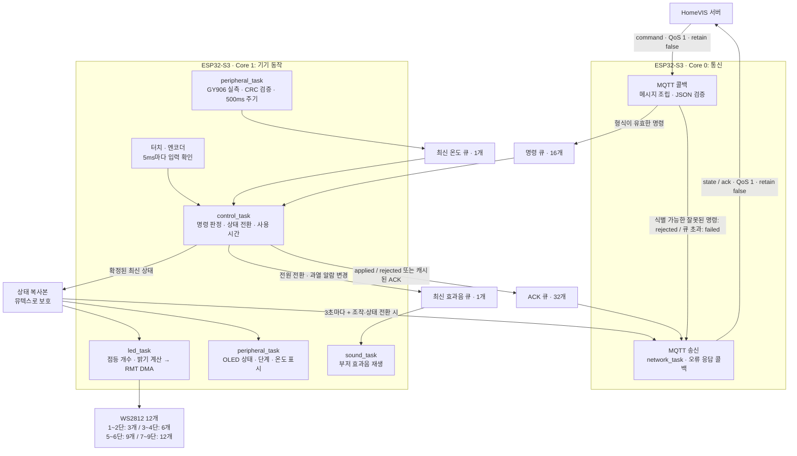

# HomeVIS Induction · ESP32-S3

ESP32-S3 기반 1구 인덕션 데모 펌웨어입니다. 실제 가열부 없이 12개 WS2812 LED의 점등 개수와 밝기로 화력을 표현합니다. 터치·엔코더로 직접 조작하거나 HomeVIS 서버에서 MQTT 명령을 보낼 수 있습니다.

## 지원 구성

- ESP32-S3-WROOM-1 **N16R8 기준**: 16MB Flash, 8MB Octal PSRAM
- ESP-IDF **5.5.4**
- WS2812/WS2812B 12개, GRB 순서
- 외부 터치 모듈: active high
- 로터리 엔코더 A/B 및 버튼: 버튼 active low
- SSD1306 128×64 I²C OLED: 주소 `0x3C`, 선택 사항
- GY906 온도센서: 주소 `0x5A`
- PWM으로 구동하는 수동 부저

## 화력별 LED 동작

LED를 원형으로 배치하고 **물리적 연결 순서대로 1~12번**으로 봅니다.

| 화력 | 켜지는 LED 수 | 켜지는 위치 | R 밝기: 기본 상한 96 |
|---|---:|---|---:|
| 0 | 0 | 없음 | 0 |
| 1 | 3 | 1, 5, 9 | 11 |
| 2 | 3 | 1, 5, 9 | 22 |
| 3 | 6 | 1, 3, 5, 7, 9, 11 | 32 |
| 4 | 6 | 1, 3, 5, 7, 9, 11 | 43 |
| 5 | 9 | 4, 8, 12번을 제외한 전체 | 54 |
| 6 | 9 | 4, 8, 12번을 제외한 전체 | 64 |
| 7 | 12 | 전체 | 75 |
| 8 | 12 | 전체 | 86 |
| 9 | 12 | 전체 | 96 |

단계가 올라가면 기존에 켜진 LED를 유지하면서 새로운 LED가 추가됩니다. 켜진 LED는 모두 같은 주황색이며 `R=밝기`, `G=밝기/8`, `B=0`입니다. 밝기는 `ceil(최대 밝기 × 단계 / 9)`로 계산합니다. 상한은 menuconfig에서 9~255로 조절할 수 있습니다.

고정 점등 방식이며 애니메이션·점멸은 없습니다. OFF, 냉각, 과열 상태에서는 화구 LED를 소등하고 OLED 상태와 부저로 구분합니다. 전원을 켠 상태의 0단계도 LED는 꺼집니다.

## 기본 배선

아래 GPIO는 **제안 기본값**입니다. 사용 중인 개발 보드의 핀 노출 여부를 확인하고 menuconfig에서 변경하세요.

| 장치 신호 | S3 GPIO | 비고 |
|---|---:|---|
| WS2812 DIN | 4 | 외부 12개 LED의 첫 DIN |
| 터치 모듈 OUT | 5 | 누르면 high |
| 엔코더 A | 6 | 내부 pull-up |
| 엔코더 B | 7 | 내부 pull-up |
| 엔코더 SW | 8 | 누르면 GND |
| 수동 부저 | 9 | LEDC PWM |
| OLED·GY906 SDA | 10 | I²C 공유 |
| OLED·GY906 SCL | 11 | I²C 공유 |

WS2812 전원은 LED 개수와 밝기에 맞는 5V 전원을 사용하고 S3와 GND를 연결합니다. LED 전원을 GPIO에서 공급하지 마세요. 5V LED의 데이터 입력 조건에 맞는 레벨 변환을 사용하면 안정적인 연결에 도움이 됩니다. 센서와 OLED의 I²C pull-up은 S3에 맞는 3.3V로 연결합니다.

N16R8에서 Flash/PSRAM용 GPIO26~37, USB GPIO19/20, 부팅 설정 GPIO0/3/45/46은 이 프로젝트의 외부 장치 핀으로 허용하지 않습니다. 중복 GPIO도 부팅 시 검사합니다. 터치는 S3 내장 정전식 터치 기능 대신 외부 디지털 터치 모듈을 사용합니다.

## 공개 설정 예시와 로컬 환경

- **공개 파일:** `main/Kconfig.projbuild.example` — 비밀번호와 실제 접속 정보가 없는 예시
- **로컬 파일:** `main/Kconfig.projbuild` — Git 제외
- **로컬 설정 결과:** `sdkconfig`, `sdkconfig.old` — Git 제외
- **보드 공통 설정:** `sdkconfig.defaults` — N16R8 성능·메모리 설정, 공개 가능

처음 CMake를 실행할 때 로컬 projbuild가 없으면 공개 예시에서 자동 생성합니다. 이미 있는 로컬 파일은 덮어쓰지 않습니다. 수동으로 시작하려면 다음 명령을 사용합니다.

```sh
cp main/Kconfig.projbuild.example main/Kconfig.projbuild
```

ESP-IDF 환경을 활성화한 터미널에서 프로젝트 디렉터리로 이동해 설정합니다.

```sh
idf.py set-target esp32s3
idf.py menuconfig
```

`HomeVIS induction configuration` 메뉴에서 다음 값을 입력합니다.

| 설정 | 의미 |
|---|---|
| Enable Wi-Fi and MQTT | 끄면 로컬 전용 동작 |
| Wi-Fi SSID / password | 현장 Wi-Fi 접속 정보 |
| MQTT broker URI | 예: `mqtt://broker.example.com:1883` |
| MQTT username / password | 브로커 인증 정보 |
| Unique MQTT client / device ID | 기본 `induction-01`, 장치마다 고유하게 설정 |
| Burner ID | 기본 `burner-1` |
| MQTT topic prefix | 기본 `home/kitchen/induction/induction-01` |
| NTP server | 기본 `pool.ntp.org`, 현장에서 접근 가능한 서버로 변경 가능 |
| Maximum LED red channel brightness | 기본 96 |
| Default level on power-on | 기본 5 |
| GPIO 설정 | 실제 배선에 맞게 수정 |

장치 ID를 바꾸면 topic prefix도 서버의 토픽 규칙에 맞게 함께 바꿉니다. SSID나 broker URI가 비어 있으면 네트워크 태스크만 종료하고 로컬 조작은 계속합니다. `mqtts://` 인증서 설정은 현재 포함하지 않았으므로 위 예시는 `mqtt://` 기준입니다.

`Kconfig.projbuild`의 default를 직접 수정한 뒤에는 기존 `sdkconfig`에 저장된 값이 우선할 수 있습니다. 기존 값은 `menuconfig`에서 변경하세요. 공개할 때는 실제 로컬 파일 대신 `.example`만 포함합니다. `.example`을 변경해도 기존 로컬 projbuild는 자동 갱신하지 않습니다.

## 빌드·업로드

```sh
idf.py build
idf.py -p /dev/ttyACM0 flash monitor
```

포트는 실제 장치에 맞게 바꿉니다. 모니터 종료는 `Ctrl+]`입니다. 보드에 업로드하기 전에 실제 모듈이 N16R8인지 확인하세요. 다른 메모리 구성이라면 `menuconfig`에서 Flash 용량과 PSRAM QUAD/OCT 모드를 맞춥니다.

## 데이터 플로우

로컬 입력과 MQTT 명령은 `control_task`에서 처리하며, 기기 상태는 이 태스크만 변경합니다. LED·OLED·네트워크 태스크는 뮤텍스로 보호된 상태 복사본을 읽습니다. 아래 MQTT 화살표는 브로커를 경유하며, 토픽의 기본 접두사는 `home/kitchen/induction/induction-01`입니다.



- **로컬 조작:** 터치·엔코더 입력을 제어 태스크가 직접 읽고 상태에 반영합니다. 해당 루프에서는 원격 명령 처리를 미룹니다.
- **온도 측정:** 주변장치 태스크가 센서 응답을 검증해 최신 온도 큐에 넣고, 제어 태스크가 온도 유효성과 냉각·과열 상태를 관리합니다. OLED 출력도 같은 주변장치 태스크가 담당해 I²C 접근을 순서대로 처리합니다.
- **원격 명령:** MQTT 콜백이 검증한 명령을 큐에 넣으면 제어 태스크가 중복 ID와 현재 상태를 확인합니다. 적용 결과와 당시 상태를 ACK 큐에 넣고, 중복 명령에는 캐시된 ACK를 재사용합니다.
- **출력과 보고:** LED는 최신 상태에 따라 점등 개수와 밝기를 바꾸고, 부저는 효과음 요청을 처리합니다. 네트워크 태스크는 상태와 일반 ACK를, 수신 콜백은 검증 오류·명령 큐 초과에 대한 ACK를 MQTT 송신 큐에 넣습니다. JSON이 깨졌거나 문자열 `commandId`가 없어 식별할 수 없는 메시지는 ACK 없이 무시합니다.

## 듀얼 코어와 메모리

| 태스크 | Core | 동작 |
|---|---:|---|
| 제어 | 1 | 5ms 입력 확인, 명령 처리, 단일 상태 소유 |
| LED | 1 | 10ms마다 최신 상태 확인, 출력 변경 때만 RMT DMA 전송 |
| 주변장치 | 1 | 온도 500ms, OLED 최대 100ms 간격 확인 |
| 부저 | 1 | 요청된 두 음 재생 |
| 네트워크 및 MQTT | 0 | Wi-Fi·시간 동기화·명령·상태·ACK |

앱 파티션은 4MB이며 나머지 Flash 공간은 향후 확장용으로 남겨 둡니다. CPU는 240MHz, PSRAM은 Octal 80MHz, FreeRTOS tick은 1kHz입니다. Wi-Fi 절전은 연결 지연을 줄이기 위해 해제합니다. 듀얼 코어 사이에는 이벤트 큐와 짧은 뮤텍스로 보호된 상태 복사본을 사용합니다.

12개 LED 데이터는 36바이트이므로 내부 DMA RAM에 둡니다. 큐와 제어 태스크 스택도 내부 RAM을 사용합니다. 상대적으로 큰 최근 64개 명령 ACK 캐시는 PSRAM에 우선 할당하고, PSRAM이 없으면 내부 RAM으로 대체합니다. 일반 malloc은 4KB 이하를 내부 RAM에 우선 배치하며 내부 DMA 메모리 32KB를 예약합니다. PSRAM 초기화 실패 시 계속 부팅하도록 설정했으며 시작 로그의 `PSRAM free`로 실제 인식 여부를 확인합니다. 실제 처리 성능은 보드에서 확인해야 합니다.

## 로컬 조작과 온도

- 터치: 켜기/끄기. 켜면 기본 5단계입니다.
- 엔코더 회전: 켜진 상태에서 0~9단계 변경.
- 엔코더 버튼: 켜진 상태를 유지하고 0단계로 변경.
- 터치·버튼: 40ms 디바운싱.
- 로컬 입력이 있으면 해당 루프의 원격 명령 처리를 미룹니다. 그 입력보다 먼저 수신된 원격 켜기/단계 변경 명령은 거절합니다. 원격 끄기는 허용합니다.

GY906의 실제 센서값을 500ms마다 읽으며 CRC를 검증합니다. 센서 오류가 나거나 측정값이 2초 이상 오래되면 OLED에 `T --- C`를 표시합니다. 화력 단계나 경과 시간은 측정 온도를 변경하지 않습니다.

기기 상태는 `off`, `on`, `cooling`, `overheated`입니다. 온도가 30°C를 넘을 때 끄면 냉각 상태가 되고 26°C 이하에서 OFF로 돌아옵니다. 기본 과열 진입/해제 온도는 150/60°C입니다. 과열 시 단계 0 및 경고음으로 전환하고, 끄기 명령만으로 과열 잠금을 해제하지 않습니다. 유효한 온도값이 해제 온도 이하로 내려와야 해제됩니다. 부저는 전원 전환과 과열 진입/해제 때 두 음을 재생합니다.

## MQTT 연동

기본 토픽은 다음과 같습니다.

```text
home/kitchen/induction/induction-01/command
home/kitchen/induction/induction-01/state
home/kitchen/induction/induction-01/ack
```

명령 예시:

```json
{
  "commandId": "command-001",
  "issuedAt": "2026-10-23T10:00:00Z",
  "burnerId": "burner-1",
  "type": "set_level",
  "level": 7
}
```

명령은 `turn_on`, `turn_off`, `set_level`입니다. 원격 level은 1~9이고, `turn_on`에서 생략하면 기본 단계를 사용합니다. `set_level`은 꺼진 상태에서도 켜면서 단계를 적용합니다. `issuedAt`은 필수 문자열이지만 만료 시간이나 순서 판정에는 아직 사용하지 않습니다. retained 명령은 실행하지 않습니다.

명령 ID는 JSON 문자열을 그대로 보존하며 영문·숫자 외 문자와 UTF-8도 허용합니다. 별도의 64자 제한은 없으며 전체 명령 메시지 크기는 최대 1024바이트입니다. 최근 64개 중복 명령은 재실행하지 않고 이전 결과와 스냅샷을 ACK로 재전송합니다. 캐시는 재부팅 시 초기화됩니다. 식별 가능한 잘못된 명령과 상태상 허용되지 않는 명령은 `rejected`, 적용한 명령은 `applied`, 명령 큐 용량 부족으로 실행하지 못한 명령은 `failed`로 보고합니다. JSON 자체가 깨졌거나 문자열 `commandId`가 없어 명령을 식별할 수 없으면 로그를 남기고 무시합니다. ACK는 제어 상태 반영 결과이며 물리 LED의 발광 여부를 검증한 결과는 아닙니다.

상태와 ACK는 모두 QoS 1, retain false로 전송합니다. 상태는 기본 3초마다 보내며 조작·명령·상태 전환 시 추가 전송합니다. 온도 샘플마다 전송하지 않습니다. `reportedAt`, `burners[]`, `lastControl`, `alarm` 필드는 현재 HomeVIS 백엔드 형식에 맞춥니다. ACK에는 `commandId`, `result`, `appliedAt`, `burnerState`를 보냅니다.

`burners[]`와 `burnerState`는 명세의 `burnerId`, `deviceState`, `level`, `temperature`, `activeSec`만 포함합니다. 센서 유효성은 내부에서 관리하고 OLED 오류 표시와 과열 판정에 사용합니다. 온도 오류 시 전송 숫자는 마지막 측정값을 유지하며 초기 측정 전에는 25°C입니다. 현재 JSON 명세에는 센서 오류를 서버에 별도로 알리는 필드가 없습니다.

부팅 직후와 직접 조작 시 `lastControl.publisher`는 `user`, 서버 명령 적용 시 `api`, 기기의 온도에 따른 자동 상태 전환 시 `system`입니다. `lastControl.commandId`는 `api`일 때만 포함하며 받은 ID를 그대로 넣습니다.

유효한 UTC 시간이 확보된 다음 MQTT를 시작합니다. 인터넷이 없는 데모 현장에서는 접근 가능한 NTP 서버를 지정해야 원격 제어가 활성화됩니다. 로컬 입력과 LED는 시간 동기화 여부와 무관하게 동작합니다. Wi-Fi는 5초 간격으로 재접속하고 MQTT 연결 복구 시 최신 상태를 다시 전송합니다.

명령 큐는 16개, ACK 큐는 32개입니다. MQTT outbox가 8KB 이상이면 추가 상태 송신을 미루지만 ACK에는 이 제한을 적용하지 않습니다. ACK 큐가 차면 명령 적용을 잠시 멈추지만 로컬 입력 처리는 계속합니다. 명령 큐까지 가득 차면 새 명령은 실행하지 않고 즉시 `failed` ACK를 MQTT 송신 큐에 넣습니다. 통신 단절이나 메모리 부족으로 ACK 자체를 송신 큐에 넣을 수 없으면 오류를 기록하며 서버의 타임아웃·재시도가 필요합니다.

## 테스트와 코드 구성

호스트에서 LED 패턴·밝기, 명령 적용, 과열 잠금, 센서 유효성을 검증합니다.

```sh
./tests/run.sh
```

| 파일 | 역할 |
|---|---|
| `main/main.c` | 태스크, 입력, 이벤트 큐, 상태 공유, ACK 캐시 |
| `main/induction_model.c` | 기기 상태 전환과 LED 개수·밝기 계산 |
| `main/induction_hw.c` | RMT DMA, OLED, GY906, 부저, GPIO |
| `main/induction_network.c` | Wi-Fi, SNTP, MQTT 명령·상태·ACK |
| `main/Kconfig.projbuild.example` | 공개용 환경 설정 예시 |
| `sdkconfig.defaults` | N16R8 공통 보드·성능 기본값 |
| `tests/test_model.c` | 하드웨어 없이 실행하는 동작 테스트 |

빌드와 호스트 테스트는 실물 배선, 센서 측정 정확도, LED 전원, 엔코더 회전 시 입력 누락 여부까지 확인하지는 않습니다. 실물 연결 후 단계별 점등과 MQTT 왕복 동작을 확인하세요.
