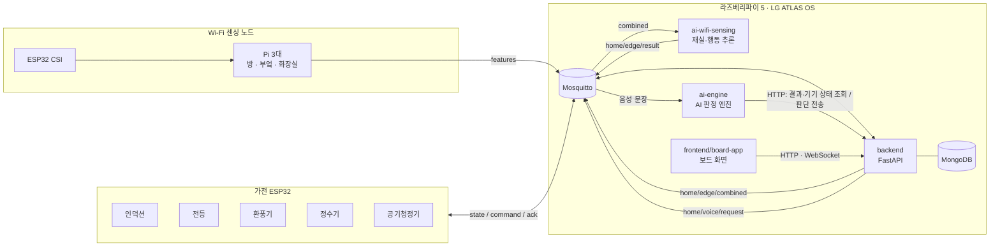

# HomeVIS

**제24회 임베디드SW경진대회(ESWC) 출품작 · 팀 SSCC**

Wi-Fi 신호로 사람이 어느 방에 있는지·어떤 행동을 하는지 추론하고, 그 결과에 맞춰 주방·욕실·방의 가전을
안전하게 자동 제어하는 1인 가구 스마트홈 시스템입니다. LG ATLAS OS가 올라간 **라즈베리파이 5 보드 한 대**에서
백엔드·AI 판정 엔진·재실 추론 서버·대시보드가 함께 돌아갑니다.

이 레포는 팀의 레포 6개를 하나로 합친 것입니다. 각 폴더는 원래 레포의 커밋 기록을 그대로 가지고 있습니다.

## 폴더 구성

| 폴더 | 역할 | 주요 기술 | 원래 레포 (브랜치) |
| --- | --- | --- | --- |
| [`backend/`](backend/) | 중앙 서버. 가전·엣지 노드 MQTT 수신, 기기 제어, AI 판단 실행, 음성 명령(STT·TTS), 낙상 대응, 대시보드 API·WebSocket | Python FastAPI, MQTT(Mosquitto), MongoDB, Docker | HomeVIS-Backend (`develop`) |
| [`frontend/`](frontend/) | 대시보드. 웹 대시보드(React)와 보드 모니터용 앱(Flutter, `board-app/`) | React + Vite, Flutter (ATLAS ipk) | HomeVIS-Frontend (`v7`) |
| [`ai-engine/`](ai-engine/) | AI 중앙 판정 엔진. 재실·행동 결과와 기기 상태로 생활·안전 시나리오를 판단해 백엔드에 제어를 요청, 음성 명령 의도 분석 | Python, OpenAI GPT | HomeVIS-AI_main (`main`) |
| [`ai-wifi-sensing/`](ai-wifi-sensing/) | Wi-Fi 센싱. 노드(Pi)에서 CSI 특징값 계산, 서버에서 재실(방 위치) + 행동(낙상·눕기·기상) 추론 | Python, scikit-learn SVM, ESP32 CSI | HomeVIS-AI_Wifi (`main`) |
| [`embedded/`](embedded/) | 가전 펌웨어. 인덕션, 욕실 전등·환풍기, 더미 기기(전등·정수기·인덕션) | ESP-IDF 5.5 (ESP32-C3/C6/S3) | HomeVIS-EM.devices (`develop`) |
| [`docker-test/`](docker-test/) | ATLAS 보드 Docker 동작 확인용 테스트 이미지 | Docker | HomeVIS-Docker_test (`main`) |

각 폴더의 README에 설치·실행 방법이 자세히 있습니다.

## 전체 구조

1. **Wi-Fi 센싱 노드**가 1초마다 방별 특징값을 MQTT로 보냅니다 (`home/{방}/edge/{노드}/features`).
2. **백엔드**가 세 노드의 최신 값을 묶어 1초마다 보냅니다 (`home/edge/combined`).
3. **재실·행동 추론 서버**가 "누가 어느 방에 있고 무엇을 하는지"를 판단해 돌려줍니다 (`home/edge/result`). 백엔드가 DB에 저장합니다.
4. **AI 판정 엔진**이 이 결과와 기기 상태를 HTTP로 읽고, 필요한 제어를 `POST /api/v1/ai/decisions`로 보냅니다.
   (예: 부엌 부재가 길어지면 인덕션 화력 낮추기, 낙상 감지 시 인덕션 차단·조명 깜빡임·보호자 알림)
5. **백엔드**가 실제 가전에 MQTT 명령을 보내고(`home/{방}/{기기}/{id}/command`), 결과(ack·state)를 대시보드에 WebSocket으로 알립니다.
6. **음성 명령**: 보드 마이크 버튼 → 백엔드 녹음·음성 인식(STT) → AI 판정 엔진 → 제어 실행 → 보드 스피커 안내(TTS).

판단은 AI 판정 엔진이, 실제 기기 제어와 저장은 백엔드가 맡습니다. 자세한 형식은 아래 문서를 참고하세요.

| 문서 | 내용 |
| --- | --- |
| [backend/docs/AI-INTEGRATION.md](backend/docs/AI-INTEGRATION.md) | AI 판정 엔진 ↔ 백엔드 HTTP 연동 |
| [backend/docs/EDGE-MQTT.md](backend/docs/EDGE-MQTT.md) | 엣지 노드·재실 결과 MQTT 형식 |
| [backend/docs/VOICE.md](backend/docs/VOICE.md) | 음성 명령 흐름 (보드 마이크·확인·자동 승인) |
| [ai-wifi-sensing/RUN_GUIDE.md](ai-wifi-sensing/RUN_GUIDE.md) | Wi-Fi 센싱 노드·서버 실행과 판단 조건 |

## 기기와 MQTT 토픽 (시연 구성)

| 방 | 기기 | ID | 토픽 |
| --- | --- | --- | --- |
| 방 | 전등 | `light-01` | `home/room/light/light-01/{state,command,ack}` |
| 방 | 공기청정기 | `air-01` | `home/room/air_purifier/air-01/...` |
| 부엌 | 인덕션 | `induction-01` | `home/kitchen/induction/induction-01/...` |
| 부엌 | 전등 | `light-02` | `home/kitchen/light/light-02/...` |
| 부엌 | 정수기 | `water-01` | `home/kitchen/water_purifier/water-01/...` |
| 부엌 | 환풍기(후드) | `fan-01` | `home/kitchen/fan/fan-01/...` |
| 화장실 | 전등 | `light-00` | `home/toilet/light/light-00/...` |
| 화장실 | 환풍기 | `fan-02` | `home/toilet/fan/fan-02/...` |

## 보드 배포 (라즈베리파이 5 · LG ATLAS OS)

보드에는 소스 없이 맥에서 만든 arm64 이미지를 옮겨 실행합니다 (`docker build --platform linux/arm64` → `docker save` → 보드에서 `docker load`).

| 보드 폴더 | 실행 | 내용 |
| --- | --- | --- |
| `/mnt/rawopt/homevis` | `docker compose -f docker-compose.yml -f docker-compose.board.yml up -d` | 백엔드, MongoDB, Mosquitto(1883), nginx 웹 대시보드(80) |
| `/mnt/rawopt/homevis-ai` | `docker compose -f compose.yaml -f compose.board.yaml up -d` | AI 판정 엔진 |
| `/mnt/rawopt/homevis-sensing` | `docker compose -f compose.board.yaml up -d` | 재실·행동 추론 서버 ([ai-wifi-sensing/board/](ai-wifi-sensing/board/)) |
| ATLAS 앱 | `abusctl call com.atlas.AppManager1 Start com.atlas.app.homevis_gui` | 보드 모니터 대시보드 (Flutter ipk) |

- ATLAS 커널이 Docker 기본 AppArmor 프로필을 받지 않아 컨테이너마다 `security_opt: ["apparmor=unconfined"]`를 씁니다.
- 보드 마이크·스피커는 pulseaudio 소켓(`/run/pulse/native`)을 백엔드 컨테이너에 연결해 사용합니다.
- 자세한 내용은 [backend/docker-compose.board.yml](backend/docker-compose.board.yml)과 [frontend/board-app/README.md](frontend/board-app/README.md)를 참고하세요.

## 비밀값

API 키(OpenAI, 문자 발송 등)는 각 폴더의 `.env`에만 넣고 커밋하지 않습니다. 형식은 각 폴더의 `.env.example`을 참고하세요.
