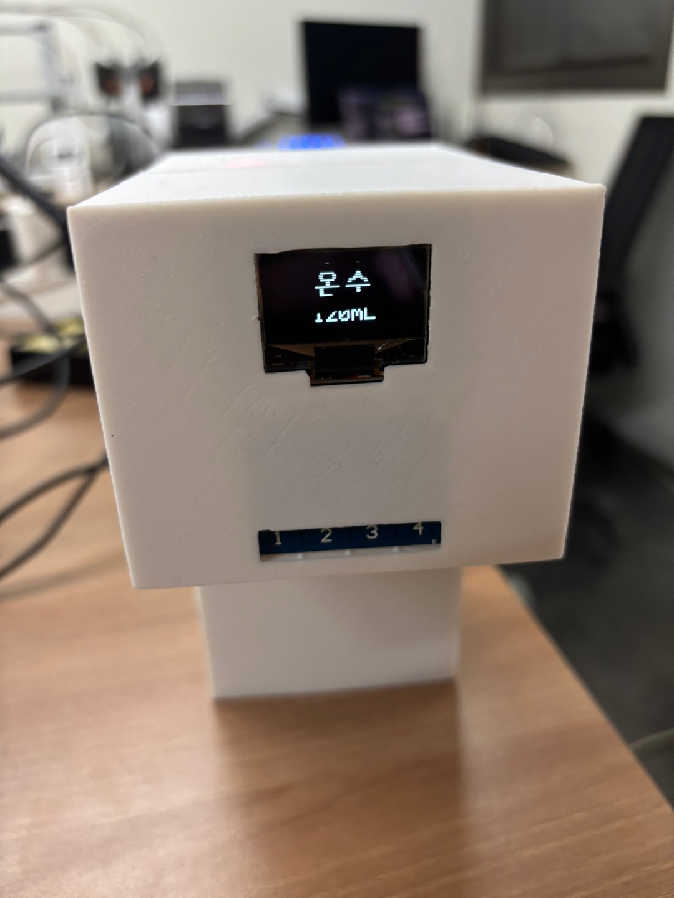

# 주방 정수기 · water-01



현재 통신은 가전 전용 Wi-Fi `HomeVIS-Devices`, MQTT `mqtt://192.168.4.1:1883`, NTP `192.168.4.1`을 사용합니다. ESP32-S3와 노트북 USB 중계 실행 방법은 [게이트웨이 README](../../gateway/esp32s3-gateway/README.md)를 참고하세요.

ESP32-C6, I²C SSD1306 128×64 OLED, 직접 출력 4개를 사용하는 터치 모듈, WS2812B 8개로 출수를 표시하는 ESP-IDF 5.5.4 프로젝트입니다. 실제 모터는 구동하지 않습니다. 출수 상태에서는 8개 모두 온수는 빨간색, 냉수·정수는 파란색으로 켜지고 완료·중지 시 꺼집니다.

## 핀 연결

핀 번호는 보드 헤더 순번이 아닌 GPIO 번호입니다.

| 부품 단자 | ESP32-C6 / 연결 대상 | 역할 |
|---|---|---|
| OLED VCC / GND | 3.3V / GND | 3.3V 지원 I²C 모듈 기준 |
| OLED SDA / SCL | GPIO6 / GPIO7 | SSD1306, 기본 주소 0x3C |
| 터치 VCC / GND | 3.3V / GND | TTP224 계열 개별 출력 기준 |
| 터치 OUT1 | GPIO0 | 온수 → 냉수 → 정수 선택 |
| 터치 OUT2 | GPIO1 | 용량 감소 |
| 터치 OUT3 | GPIO2 | 용량 증가 |
| 터치 OUT4 | GPIO3 | 출수 시작 / 출수 중 정지 |
| WS2812B DIN | GPIO18 | 8개 LED 데이터 입력 |
| WS2812B 5V | LED 정격에 맞는 5V 전원 | ESP32 3.3V 핀에서 공급하지 않습니다 |
| WS2812B GND | 전원 GND 및 ESP32 GND | 공통 GND |

기존 L9110S와 모터 배선은 분리합니다. GPIO19는 사용하지 않습니다. LED 스트립은 DOUT이 아닌 DIN에 연결하며, 5V 구동 시 데이터 신호를 안정적으로 전달하려면 3.3V→5V 로직 레벨 시프터를 사용합니다. 외부 전원과 USB 전원의 +를 임의로 병렬 연결하지 않습니다.

LED는 SPI2 DMA로 전송합니다. 8개 모두 온수는 RGB(255,0,0), 냉수·정수는 RGB(0,0,255)로 표시합니다. 기본 `WP_LED_BRIGHTNESS`는 255(100%)이며 빨간색과 파란색 채널에 동일하게 적용합니다. LED 수는 8개로 고정되어 있습니다. 부팅 시 전체 소등 프레임을 먼저 전송합니다.

OLED와 터치는 ESP32 입력에 5V가 들어오지 않도록 3.3V 논리 신호를 사용합니다. 터치 모듈은 **누르는 동안만 활성화되는 direct/momentary 모드**로 사용합니다. 기본은 active HIGH이며 active LOW 모듈은 설정에서 바꿀 수 있습니다. 토글 모드는 지원하지 않습니다. 전원 투입 후 1초 동안 터치 초기화를 기다리고, 부팅 중 누르고 있던 키는 뗐다가 다시 눌러야 합니다.

허용 GPIO는 0/1/2/3/6/7/18~23이며 중복 배정은 부팅 시 거부합니다. 다른 ESP32-C6 보드는 해당 GPIO의 실제 노출 여부를 확인해 주세요.

## 조작

부팅 시 LED OFF, 정수 선택, 용량 120mL로 시작합니다.

| 터치 | 동작 |
|---|---|
| 1 | 온수 → 냉수 → 정수 → 온수 순환 |
| 2 | 480 → 360 → 240 → 120mL 감소 |
| 3 | 120 → 240 → 360 → 480mL 증가 |
| 4 | 대기 중에는 선택한 용량 출수, 출수 중에는 중지 |

최솟값·최댓값에서 더 누르면 현재 용량을 유지합니다. 출수 중 1~3번은 무시하며 4번이 우선합니다. 입력은 40ms 디바운싱하고 길게 눌러도 반복하지 않습니다.

**온수·냉수·정수는 선택 표시만 제공합니다.** 현재 구성에서는 실제 물을 내보내거나 온도를 조절하지 않습니다. OLED 중앙에는 한글 `온수` / `냉수` / `정수`를 표시하고, 아래에는 선택한 용량(예: `120mL`)을 크게 표시합니다. 출수를 시작하면 같은 자리에 `0mL`부터 시간 기반 시연 진행량이 올라갑니다. 완료하거나 중지하면 선택 용량으로 돌아옵니다. 서버 출수는 선택 용량과 관계없이 120mL까지 진행합니다. OLED가 연결되지 않아도 LED와 터치 제어는 동작합니다.

한글 4글자 비트맵은 나눔고딕 Bold에서 변환했으며 출처와 라이선스는 `fonts/`에 포함되어 있습니다.

## 설정 및 업로드

ESP-IDF 터미널에서 이 폴더로 이동해 실행합니다.

```bash
idf.py menuconfig
idf.py build
idf.py -p /dev/ttyACM0 flash monitor
```

포트는 실제 연결에 맞게 변경합니다. 프로젝트 타깃은 ESP32-C6, Flash 기본 설정은 4MB, 콘솔은 USB Serial/JTAG입니다.

첫 CMake 실행 시 `main/Kconfig.projbuild.example`을 로컬 `main/Kconfig.projbuild`로 복사합니다. Wi-Fi·MQTT·NTP·GPIO·LED 밝기·터치 극성·OLED 주소·시연 속도·최대 시연 시간을 `HomeVIS water purifier` 메뉴에서 관리합니다. `Kconfig.projbuild`와 `sdkconfig`는 Git에서 제외합니다. 기존 `sdkconfig`가 있으면 `Kconfig.projbuild`의 default 변경만으로 적용되지 않으므로 `menuconfig`에서 수정합니다.

SSID 기본값은 `HomeVIS-Devices`입니다. 공개 템플릿의 비밀번호는 비어 있으므로 로컬 설정에 가전망 비밀번호를 입력해야 접속할 수 있습니다. MQTT는 최초 NTP 동기화 후 시작합니다. TLS URI는 ESP-IDF 공인 CA 번들로 인증합니다.

## 시연 시간

`WP_FLOW_ML_PER_MIN`은 실제 유량이 아닌 출수 시연 속도입니다. 기본값 600mL/min(10mL/s)에서 120/240/360/480mL의 LED 점등 시간은 각각 12/24/36/48초입니다. 4번 터치나 서버 `stop` 명령으로 즉시 소등할 수 있습니다.

`WP_MAX_RUN_SEC`는 기본 120초입니다. 계산된 시연 시간이 한도를 초과하면 명령을 거부합니다. OLED는 별도 태스크이므로 I²C 타임아웃이 출수 표시 제어를 직접 막지 않습니다. 모터용 차단 타이머는 제거했으며 제어 루프가 정해진 시연 시간에 소등합니다.

`main/Kconfig.projbuild`에서 `WP_LED_GPIO`(기본 18), `WP_LED_BRIGHTNESS`(기본 255)를 설정합니다. OLED와 터치 GPIO는 기존 설정을 유지합니다.

## MQTT

JSON UTF-8, QoS 1, retain false를 사용합니다.

```text
home/kitchen/water_purifier/water-01/state
home/kitchen/water_purifier/water-01/command
home/kitchen/water_purifier/water-01/ack
```

상태는 5초마다, 출수 시작·종료·중지·선택 변경 시, 재접속 시 보냅니다. UTC ISO 8601(`Z`) 시각을 사용합니다.

```json
{
  "reportedAt": "2026-10-27T05:00:00Z",
  "status": "dispensing",
  "lastDispensedMl": 240,
  "targetMl": 120,
  "volumeEstimated": true,
  "simulated": true,
  "selectedMl": 480,
  "selectedWaterType": "purified",
  "temperatureControlAvailable": false,
  "lastControl": { "publisher": "api", "commandId": "water-1" }
}
```

`lastDispensedMl`은 가장 최근 완료·중지한 출수의 **시연상 계산된 양**입니다. `simulated: true`이므로 실제로 나온 물의 양이 아닙니다. 새 출수 시작 시에는 이전 값을 유지하고 완료·중지 시 갱신합니다. 목표량은 별도의 `targetMl`에 표시합니다. 초기 이전 출수량은 0입니다. `selectedWaterType`은 선택 표시이고 실제 수온이 아닙니다.

서버의 출수 명령은 **무조건 120mL**입니다. 전달된 `amountMl`은 사용하지 않으며 없어도 120mL로 처리합니다. 이 동작은 기존 범용 프로토콜의 요청 용량 처리 대신 이번 기기의 요구사항을 따른 것입니다.

```json
{"commandId":"water-1","issuedAt":"2026-10-27T05:00:00Z","deviceId":"water-01","type":"dispense","amountMl":480}
```

위 요청도 실제 목표량은 120mL입니다. 로컬에서 선택한 용량은 변경하지 않습니다. 서버 요청에 온도 선택은 없으며 현재 화면 선택을 유지합니다. 출수 중 새 출수 명령은 `busy`로 거절하고 예약하지 않습니다.

중지용 확장 명령도 지원합니다.

```json
{"commandId":"water-stop-1","issuedAt":"2026-10-27T05:00:01Z","deviceId":"water-01","type":"stop"}
```

ACK는 `commandId`, `result`(`applied`/`rejected`/`failed`), `appliedAt`, `state` 스냅샷을 포함하고 오류 시 `reason`을 추가합니다. 출수 명령의 `applied`는 LED 출수 시연 적용을 뜻하며 실제 물 120mL 출수 완료를 보증하지 않습니다. 완료는 이후 `status: idle` 상태로 보고합니다. 서버 제어는 `lastControl.publisher=api`, 로컬 조작은 `user`이고 정상 시간 종료는 출수를 시작한 제어 주체를 유지합니다.

최근 32개 commandId는 RAM에 보관하여 QoS 1 중복을 재실행하지 않고 원래 ACK를 돌려줍니다. 재부팅하면 캐시는 사라집니다. 다른 명령에는 새 ID를 사용합니다. retained 명령은 무시합니다. 로컬 중지 이전에 수신되어 대기하던 출수 명령은 취소하며, 4번 키를 누르고 있는 동안에는 서버 출수 요청을 거절합니다. 통신 단절 시 진행 중인 출수는 정해진 시간에 끝나고, 재부팅 시 진행 중 작업을 재개하지 않습니다.

명령은 최대 1024바이트, commandId 최대 127바이트, JSON 깊이 최대 16입니다. `issuedAt`은 필수 문자열이나 날짜 형식·명령 만료 시각은 검증하지 않습니다. 명령 큐는 8개, outbox는 16KB로 제한합니다. 과부하로 실행되지 않은 명령은 같은 ID로 재시도할 수 있습니다.

## 테스트

호스트 테스트는 일반 개발용 셸에서 `IDF_PATH`를 설치된 ESP-IDF 5.5.4 경로로 지정해 실행해 주세요. 교차 링커가 우선되는 경우의 실행 방법은 [공통 검증 안내](../../README.md#빌드와-검증)를 참고해 주세요.

```bash
ASAN_OPTIONS=detect_leaks=0 sh tests/run.sh
```

ESP-IDF 활성화 후 실행합니다. 선택 순환·용량 경계·출수 중 선택 차단·서버 120mL 고정·출수 시간·중지 추정량·중복 출수 거부·최대 시간·JSON/ACK를 검사합니다. 실물에서는 OLED 모델/주소, 터치 극성, 8개 LED 온수 빨간색·냉수/정수 파란색 표시 및 소등과 시연 시간, 반복 중지 및 MQTT 왕복을 확인해야 합니다.

## 부품 자료

- [ESP32-C6 DevKitC-1 핀 배치](https://docs.espressif.com/projects/esp-dev-kits/en/latest/esp32c6/esp32-c6-devkitc-1/user_guide.html)
- [Tontek TTP224B 데이터시트](https://www.tontek.com.tw/uploads/product/110/TTP224B_V1.1_EN.pdf): 전압과 direct/toggle·극성 옵션
