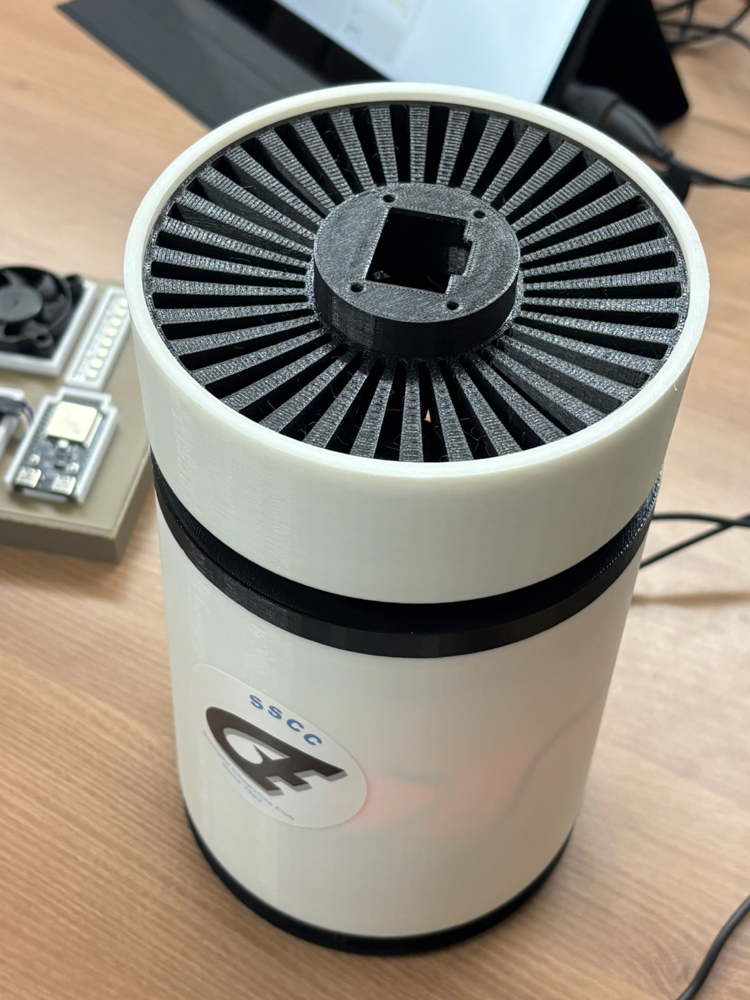

# 방 공기청정기 · air-01



현재 통신은 가전 전용 Wi-Fi `HomeVIS-Devices`, MQTT `mqtt://192.168.4.1:1883`, NTP `192.168.4.1`을 사용합니다. ESP32-S3와 노트북 USB 중계 실행 방법은 [게이트웨이 README](../../gateway/esp32s3-gateway/README.md)를 참고하세요.

ESP32-C6에서 릴레이로 팬 전원을 제어하고 MQ135 아날로그 출력을 읽는 ESP-IDF 5.5.4 프로젝트입니다. 부팅 시 `manual`, 팬 OFF로 시작하며, Wi-Fi 연결 여부와 관계없이 센서를 측정합니다. 팬 속도 제어는 지원하지 않습니다.

## 배선

| 장치 | 기본 연결 | 설정 |
|---|---|---|
| 릴레이 IN | GPIO18 | `AP_RELAY_GPIO` |
| 릴레이 제어 극성 | LOW일 때 ON | `AP_RELAY_ACTIVE_LOW` |
| MQ135 VCC | 5V | `AP_MQ135_SUPPLY_MV=5000` |
| MQ135 AO | 분압 회로를 거쳐 GPIO0 | `AP_MQ135_GPIO` |
| MQ135 DO | 연결하지 않습니다 | 아날로그 출력만 사용합니다 |
| 센서·릴레이 제어 GND | ESP32 GND와 공통 연결 | 팬 전원은 정격에 맞게 별도 공급합니다 |

MQ135 히터는 제조사 기준 5V로 구동합니다. **5V 모듈의 AO를 ESP32 GPIO에 직접 연결하지 마세요.** 예를 들어 AO와 ADC 사이 10kΩ, ADC와 GND 사이 10kΩ으로 1/2 분압하면 AO 5V가 ADC에서 약 2.5V가 됩니다. ADC와 GND 사이 100nF 커패시터를 추가할 수 있습니다. 이 프로젝트의 `adcMv`는 ADC 핀 전압입니다. 현재 확인된 직결 배선에 맞춰 계산 배율은 `AP_MQ135_DIVIDER_MILLI=1000`입니다. **전원을 끄고 위 1/2 분압을 추가한 뒤 이 값을 `2000`으로 변경해 주세요.** 이 설정은 계산용이며 GPIO 과전압을 막아주지 않습니다. 분압 저항이 센서 부하와 병렬로 연결되는 모듈은 `RL`도 실효 저항으로 조정해야 합니다(모듈 RL=10kΩ, 외부 직렬 합계 20kΩ이면 약 6667Ω). 실제 모듈의 출력 회로와 공급 전압도 확인해 주세요.

릴레이는 ESP32의 3.3V 제어 신호에 대응하는 모듈을 사용합니다. 팬 전원은 릴레이 COM/NO 접점으로 제어하며 GPIO로 직접 공급하지 않습니다. 펌웨어는 출력 활성화 전에 OFF 레벨을 설정합니다. 리셋 중에는 소프트웨어가 핀을 제어할 수 없으므로 릴레이 입력이 OFF를 유지하도록 하드웨어 풀업/풀다운을 구성해 주세요.

허용하는 릴레이 GPIO는 0/1/2/3/6/7/18~23, ADC GPIO는 0/1/2/3/6입니다. GPIO 중복과 임계값 순서는 부팅 시 검사합니다. ESP32-C6의 부팅·USB·UART·Flash 관련 핀과 모듈에 따라 노출되지 않는 핀은 기본 사용 범위에서 제외합니다.

## 설정과 빌드

첫 CMake 실행 시 `main/Kconfig.projbuild.example`을 `main/Kconfig.projbuild`로 복사합니다. 기존 로컬 설정은 덮어쓰지 않으며, 접속 정보가 들어가는 `Kconfig.projbuild`와 `sdkconfig`는 Git에서 제외합니다.

ESP-IDF 터미널에서 이 프로젝트 폴더로 이동해 실행합니다.

```bash
idf.py menuconfig
idf.py build
idf.py -p /dev/ttyACM0 flash monitor
```

포트는 실제 연결된 장치에 맞춰 변경해 주세요. 타깃은 ESP32-C6, 기본 Flash 크기는 4MB, 콘솔은 USB Serial/JTAG입니다. 더 큰 Flash 보드에서도 기본 파티션은 4MB 영역만 사용합니다.

`HomeVIS air purifier` 메뉴에서 Wi-Fi, MQTT, NTP, 릴레이 극성, ADC 핀과 임계값을 설정합니다. **기존 `sdkconfig`가 있으면 `Kconfig.projbuild`의 default 변경만으로 값이 바뀌지 않습니다.** 이때는 `menuconfig`로 값을 변경합니다. 기본 Wi-Fi SSID는 `HomeVIS-Devices`이며 공개 템플릿에는 비밀번호가 없으므로 로컬 설정이 필요합니다. MQTT는 최초 NTP 동기화 후 시작하고 `mqtts://`는 ESP-IDF CA 인증서 번들을 사용합니다.

| 설정 | 초기값 | 의미 |
|---|---|---|
| `AP_MQ135_SUPPLY_MV` | 5000mV | 센서 측정 회로의 공급 전압 Vc |
| `AP_MQ135_DIVIDER_MILLI` | 1000 | AO/ADC 전압 배율 ×1000; 동일 저항으로 1/2 분압 시 2000 |
| `AP_MQ135_RL_OHM` | 10000Ω | 첨부 코드의 부하 저항 초기값; 실제 실효 부하에 맞게 변경 |
| `AP_MQ135_R0_OHM` | 10000Ω | 첨부 코드의 기준 저항 초기값; 센서별 보정 필요 |
| `AP_WARMUP_SEC` | 180초 | 부팅 후 측정 안정화 대기 |
| `AP_GOOD_RAW` | 1500 | 이 값 이하이면 good, 자동 모드 팬 OFF |
| `AP_BAD_RAW` | 2200 | 이 값 이상이고 very_bad 미만이면 bad, 자동 모드 팬 ON |
| `AP_VERY_BAD_RAW` | 3000 | 이 값 이상이면 very_bad, 자동 모드 팬 ON |

good와 bad 임계값 사이에서는 `normal`로 보고하며 자동 모드 팬 상태를 유지합니다. **임계값은 시연용 초기값이며 ppm·AQI·건강 기준이 아닙니다.** 센서별 편차와 분압 비율을 반영하여 실물 측정으로 조정해야 합니다. 전원이 공급된 새 센서의 초기 컨디셔닝은 제조사가 명시한 48시간 초과 예열을 따릅니다. 180초 설정은 이를 대체하지 않으며, 컨디셔닝된 센서도 실제 안정화 시간을 확인해 조정해야 합니다.

센서는 약 1초마다 ADC 16회 평균으로 읽습니다. 12비트 원시값은 0~4095이며, 레일 값 0/4095 또는 읽기 실패는 무효로 처리합니다. ADC 보정이 가능하면 `adcMv`도 제공합니다. 이 검사는 모든 단선이나 센서 고장을 감지하지 못합니다.

## 측정 로그

시리얼 모니터에는 네트워크 연결 여부와 관계없이 약 1초마다 측정 로그가 나옵니다.

```text
MQ135 raw=2300 adcMv=1700 level=bad status=ready warmupLeft=0s mode=auto fan=on ppm=18.580 (estimated)
```

`raw`는 ADC 원시값, `adcMv`는 분압 후 ADC 핀의 보정 전압(mV)입니다. 읽지 못한 값은 `N/A`, 예열 중 등급은 `unknown`으로 표시하고 `warmupLeft`에 남은 예열 시간을 표시합니다. ADC가 0/4095이면 오류 상태와 함께 해당 원시값을 그대로 로그에 보여줍니다. 로그의 `unknown`은 진단용이며 MQTT에는 기존처럼 `level: null`을 보냅니다. ppm은 첨부 `mq135.c`의 CO₂ 환산 추정식으로 표시합니다. 예열 중, 센서 오류, ADC 전압 보정 불가, 전압·계산 조건이 잘못된 경우에는 `N/A`입니다.

## MQTT

JSON UTF-8, QoS 1, retain false를 사용합니다.

```text
home/room/air_purifier/air-01/state
home/room/air_purifier/air-01/command
home/room/air_purifier/air-01/ack
```

상태는 5초마다, 전원·모드·공기질 등급·측정 유효성 변경 시, 재접속 시 보고합니다. 원시 ADC 수치만 변하면 다음 주기 보고에 포함합니다. 시각은 UTC ISO 8601(`Z`)입니다.

```json
{
  "reportedAt": "2026-10-27T05:00:00Z",
  "power": "on",
  "mode": "auto",
  "airQuality": {
    "sensor": "mq135",
    "ppm": 18.580,
    "ppmValid": true,
    "ppmEstimated": true,
    "ppmType": "co2_equivalent",
    "level": "bad",
    "levelBasis": "adc_raw",
    "valid": true,
    "status": "ready",
    "raw": 2300,
    "adcMv": 1700
  },
  "lastControl": { "publisher": "system" }
}
```

위 수치는 형식 예시입니다. Backend v0.11의 `app/schemas.py`는 `ppm`(0 이상 또는 null)과 `level`(`good`/`normal`/`bad`/`very_bad` 또는 null)을 받습니다. 추가 센서 필드는 그대로 저장·전달합니다. 토픽과 `on`/`off`/`set_mode`, ACK 형식은 기존 규격을 유지합니다.

첨부 코드의 계산식을 적용하며, 원본에 고정된 3.3V는 실제 공급 전압인 5V로 변경했습니다.

```text
Vout = adcMv × (AP_MQ135_DIVIDER_MILLI / 1000)
Rs = RL × (Vc - Vout) / Vout
ppm = 116.6020682 × (Rs / R0)^(-2.769034857)
```

Vc와 Vout은 모두 mV, RL과 R0는 모두 Ω입니다. ADC 전압은 ESP-IDF의 보정 결과를 사용하며, 보정 불가 시 임의의 1100mV 기준으로 환산하지 않습니다. `ppmValid`는 계산 가능 여부이고 `ppmEstimated: true`, `ppmType: "co2_equivalent"`는 참고용 추정치임을 표시합니다. RL/R0 초기값은 첨부 코드에서 가져온 값이며 실제 센서 보정값은 아닙니다. 예를 들어 직결·5V·RL=R0=10kΩ에서 ADC 437mV는 약 0.176ppm으로 계산됩니다. 이는 실제 실내 CO₂ 농도를 뜻하지 않으며, 임의로 400ppm 등에 맞추지 않습니다.

공기질 등급과 자동 팬 제어는 기존 ADC 임계값을 유지합니다. 첨부 코드의 임의 AQI 매핑과 PMS7003 기반 제어는 적용하지 않습니다. PM2.5·PM10 값도 보내지 않습니다.

정상 측정의 ADC 등급은 기본 설정에서 `1~1500: good`, `1501~2199: normal`, `2200~2999: bad`, `3000~4094: very_bad`입니다. 이는 실제 농도·건강 기준이 아닌 설정 가능한 시연용 기준입니다. `levelBasis: "adc_raw"`로 판정 근거를 표시합니다.

- 예열 중: `ppm: null`, `ppmValid: false`, `status: "warming_up"`, `level: null`, `valid: false`. 원시값과 보정 전압은 읽힌 값으로 보고합니다.
- 센서 오류: `ppm: null`, `ppmValid: false`, `status: "sensor_error"`, `level: null`, `valid: false`, `raw`, `adcMv`는 `null`입니다.
- 정상 측정: `status: "ready"`, `valid: true`, `level`은 위 네 등급 중 하나입니다. 여기서 valid는 ADC 등급 판정 가능 여부이며 ppm 보정 여부가 아닙니다.
- ADC 보정 불가: 원시값과 등급은 유지하고 `adcMv`와 `ppm`이 `null`, `ppmValid: false`입니다.

서버가 허용하지 않는 문자열 `unknown`은 전송하지 않습니다. 예열·오류 상태도 서버에서 거부되지 않도록 `level: null`을 사용합니다.

명령은 각각 별도 메시지로 발행합니다.

```json
{"commandId":"air-on-1","issuedAt":"2026-10-27T05:00:00Z","deviceId":"air-01","type":"on"}
```

```json
{"commandId":"air-off-1","issuedAt":"2026-10-27T05:00:01Z","deviceId":"air-01","type":"off"}
```

```json
{"commandId":"air-auto-1","issuedAt":"2026-10-27T05:00:02Z","deviceId":"air-01","type":"set_mode","mode":"auto"}
```

`on`/`off`는 수동 모드로 전환하여 해당 전원을 유지합니다. 외출 등의 `off` 명령 후 센서 때문에 다시 켜지지 않습니다. 자동 제어를 재개하려면 `set_mode: auto`를 보냅니다. `set_mode: manual`은 현재 전원을 유지하고 자동 제어만 해제합니다.

자동 모드에서는 bad·very_bad에서 켜고, good에서 끄며 normal에서는 전원을 유지합니다. 예열·센서 오류 시 팬을 OFF로 유지하고, 유효한 측정이 복구되면 임계값에 따라 다시 제어합니다. 수동 모드에서는 센서 오류가 팬 명령을 막지 않습니다. 통신이 끊겨도 현재 모드의 동작을 유지하며 재부팅하면 항상 수동 OFF로 시작합니다. 센서 히터는 팬 릴레이와 별도로 계속 전원을 공급해야 합니다.

서버 명령으로 바뀌면 `lastControl.publisher: api`와 `commandId`, 자동 제어로 전원이 바뀌면 `system`, 부팅 직후에는 `user`를 보고합니다. `set_mode`를 적용하면서 즉시 전원이 바뀌는 경우는 해당 서버 명령의 결과인 `api`입니다.

ACK에는 요청한 `commandId`, `result`(`applied`/`rejected`/`failed`), `appliedAt`, 전체 `state` 스냅샷과 오류 시 `reason`이 들어갑니다. `applied`는 GPIO 출력 성공을 뜻하며, 팬 회전이나 릴레이 접점을 별도 센서로 확인하지는 않습니다.

명령 최대 1024바이트, commandId 최대 127바이트, 중첩 깊이 최대 16으로 제한합니다. `issuedAt`은 필수 문자열이며 날짜 문법이나 만료 시각까지 검증하지는 않습니다. 유효한 ID 없는 메시지는 로그만 남기고 실행하지 않습니다. 최근 32개 ID는 RAM에 캐시하여 재수신 시 재실행하지 않고 원래 ACK를 돌려줍니다. 재부팅 후 캐시는 사라집니다. 대기 명령은 8개, MQTT outbox는 16KB이며 과부하로 실행되지 않은 요청은 같은 ID로 재시도해야 합니다. retained 명령은 실행하지 않습니다.

## 검증

호스트 테스트는 일반 개발용 셸에서 `IDF_PATH`를 설치된 ESP-IDF 5.5.4 경로로 지정해 실행해 주세요. 교차 링커가 우선되는 경우의 실행 방법은 [공통 검증 안내](../../README.md#빌드와-검증)를 참고해 주세요.

ESP-IDF 환경에서 다음 명령을 실행합니다.

```bash
ASAN_OPTIONS=detect_leaks=0 sh tests/run.sh
```

ppm 추정식, 분압 전후 일치, 잘못된 입력의 null 처리, 명령 파싱, 네 등급 경계와 null 상태, 수동/자동 모드, 두 임계값 사이 팬 유지, 수동 OFF 이후 자동 재기동 방지, 예열, 센서 오류, JSON/ACK를 검사합니다. 실제 릴레이 극성, 팬 작동, ADC 전압, 센서 안정화와 임계값, MQTT 브로커 왕복은 실물에서 추가 확인해야 합니다.

통합 저장소의 `backend/` 폴더가 있으면 실제 서버 Pydantic 스키마와 C 펌웨어 JSON을 대조할 수 있습니다. ESP-IDF와 Pydantic v2가 있는 Python 환경에서 실행합니다.

```bash
python tests/check_backend.py
# 다른 경로라면: python tests/check_backend.py /path/to/backend
```

이 검사는 ppm 추정값·네 등급·예열·센서 오류의 실제 C 상태/ACK를 서버 스키마로 검증하고, 서버가 생성한 on/off/set_mode 명령을 C 파서에 넣어 처리 결과를 확인합니다.

## 참고 자료

- [Winsen MQ135 매뉴얼](https://www.winsen-sensor.com/manual/mq135.html): 센서 특성과 히터 전압·예열 조건
- [ESP-IDF 5.5.4 ADC oneshot](https://docs.espressif.com/projects/esp-idf/en/v5.5.4/esp32c6/api-reference/peripherals/adc/adc_oneshot.html): ADC 읽기 API
- [ESP32-C6 DevKitC-1](https://docs.espressif.com/projects/esp-dev-kits/en/latest/esp32c6/esp32-c6-devkitc-1/user_guide.html): 핀 배치
