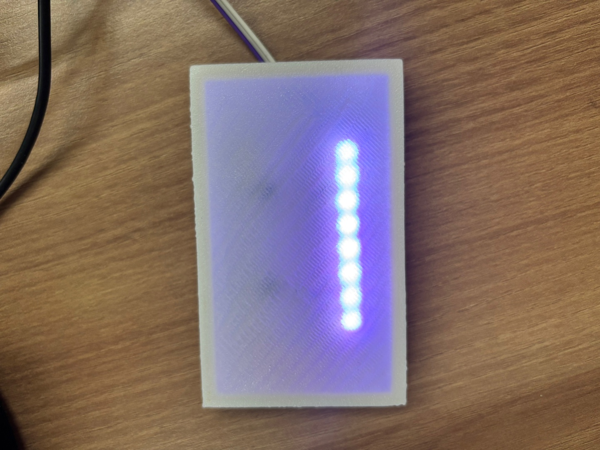

# HomeVIS 방 전등



현재 통신은 가전 전용 Wi-Fi `HomeVIS-Devices`, MQTT `mqtt://192.168.4.1:1883`, NTP `192.168.4.1`을 사용합니다. ESP32-S3와 노트북 USB 중계 실행 방법은 [게이트웨이 README](../../gateway/esp32s3-gateway/README.md)를 참고하세요.

ESP32-C6에서 WS2812B 8개 스트립을 하나의 방 전등으로 제어합니다.
기기 ID는 `light-01`이며, 모든 픽셀이 같은 흰색과 밝기로 동작합니다.
ESP-IDF 5.5.4, `esp32c6` 타깃, 4MB 플래시와 USB Serial/JTAG 콘솔을 기본으로 사용합니다.

## 배선과 LED 설정

| 항목 | 기본값 | projbuild 설정 |
| --- | --- | --- |
| WS2812B DIN | GPIO4 | `RL_LED_GPIO` |
| LED 개수 | 8개 | `RL_LED_COUNT` |
| 100% 밝기에서 RGB 각 채널 상한 | 32/255 | `RL_LED_MAX_BRIGHTNESS` |

스트립의 DIN 방향으로 연결하고, LED에는 별도 5V 전원을 공급하며 보드와 GND를 공통으로 연결합니다.
5V WS2812B의 데이터 입력은 74AHCT125 등 3.3V→5V 신호 변환기를 거치는 구성을 권장합니다.
사용 가능한 GPIO는 0~7/10/11/18~23입니다. USB GPIO12/13, UART GPIO16/17,
스트래핑 GPIO8/9/15 및 플래시 핀은 제외했습니다. 기존 배선에 맞춰 기본 GPIO4는 유지하지만,
GPIO4/5도 C6 스트래핑 핀이므로 리셋 중 외부 회로가 해당 핀의 전압을 강제로 바꾸지 않도록 주의하세요.

MQTT의 `brightness: 100`은 설정한 출력 상한을 의미합니다. 상한 32에서 100%는 각 채널 32,
절전 밝기 20%는 약 6입니다. LED 개수와 상한은 실제 스트립·전원에 맞춰 변경할 수 있습니다.
부팅 시 네트워크 연결 전에 스트립 전체를 OFF로 초기화합니다.

## 환경 설정과 실행

로컬 환경은 `main/Kconfig.projbuild`에서 정의합니다. 최초 구성 시
`main/Kconfig.projbuild.example`을 복사해 자동 생성하며, 기존 파일은 덮어쓰지 않습니다.
접속 정보가 담기는 로컬 파일과 `sdkconfig`는 Git에서 제외됩니다.

```bash
# ESP-IDF 5.5.4 환경을 먼저 활성화해 주세요.
cd /path/to/2026ESWContest_smart_SSCC/embedded/room/room-light
idf.py menuconfig
idf.py build
idf.py -p /dev/ttyACM0 flash monitor
```

`HomeVIS room light` 메뉴에서 설정합니다. 실제 연결 포트는 보드에 맞춰 변경하세요.

| 설정 | 설명 |
| --- | --- |
| Wi-Fi SSID / password | SSID 필수, 비밀번호 공백은 개방형 네트워크 |
| MQTT broker URI | 기본 `mqtt://192.168.4.1:1883`, 실제 서버 주소로 변경 |
| MQTT username / password | 인증을 사용하면 입력 |
| MQTT client ID | 기본 `homevis-room-light`, 물리 보드마다 고유한 값 사용 |
| NTP server | 기본 `192.168.4.1` |
| WS2812B 설정 | GPIO, LED 개수, 출력 상한 |

menuconfig 값은 ESP-IDF의 `sdkconfig`에 저장됩니다. 빌드 후 `Kconfig.projbuild`의 `default`를
수정해도 기존 `sdkconfig`가 우선하므로, 이미 설정한 값은 menuconfig에서도 변경하세요.
SSID가 비어 있으면 네트워크를 시작하지 않으며 스트립은 OFF 상태를 유지합니다.
`mqtts://`는 공개 CA 인증서 번들로 검증하며, 사설 CA 브로커는 별도 CA 설정이 필요합니다.

다른 타깃으로 구성한 프로젝트라면 설정을 백업한 뒤 `idf.py set-target esp32c6`를 먼저 실행합니다.
이 명령은 sdkconfig를 재생성하므로 Wi-Fi와 GPIO 등 기존 설정을 다시 확인하세요.
폴더 이동 후에는 이전 경로가 저장된 `build/`를 백업하고 새로 빌드하세요.

## MQTT 규약

| 기능 | 토픽 |
| --- | --- |
| 상태 | `home/room/light/light-01/state` |
| 명령 | `home/room/light/light-01/command` |
| 처리 결과 | `home/room/light/light-01/ack` |

모든 구독·발행은 QoS 1, retain false입니다. 상태는 연결·재연결 시, 변경 시,
그리고 마지막 발행 후 5초마다 보냅니다. SNTP로 시각을 확보한 뒤 MQTT를 시작하며,
시간은 UTC ISO 8601(`Z`)으로 보냅니다.

전등은 `on`, `off`, `blink`, `fadeout`을 지원합니다. 각 예시는 별도의 메시지입니다.

```json
{"commandId":"room-on-1","issuedAt":"2026-10-27T15:00:00+09:00","deviceId":"light-01","type":"on","brightness":100}
```

```json
{"commandId":"room-off-1","issuedAt":"2026-10-27T15:00:01+09:00","deviceId":"light-01","type":"off"}
```

```json
{"commandId":"room-blink-1","issuedAt":"2026-10-27T15:00:02+09:00","deviceId":"light-01","type":"blink","durationSec":10}
```

```json
{"commandId":"room-save-1","issuedAt":"2026-10-27T15:00:03+09:00","deviceId":"light-01","type":"fadeout","brightness":20,"durationSec":3}
```

- `on`: 전체 LED를 즉시 100% 밝기로 켭니다. `brightness`는 생략 가능하며, 보내면 100이어야 합니다.
- `off`: 전체 LED를 즉시 끄고 진행 중인 애니메이션을 취소합니다.
- `blink`: 500ms마다 켜고 끈 뒤 이전 전원·밝기로 복귀합니다. 깜빡임 중 새 `on`/`off`를 받으면
  이전 상태로 복귀하지 않습니다. 진행 중이던 절전 동작은 원래 시간 기준으로 복귀합니다.
- `fadeout`: 현재 밝기에서 목표 밝기까지 서서히 낮추고 전원은 켠 채로 유지합니다.
  절전 목표는 예시처럼 20%이며, 허용 범위는 1~100입니다. 꺼진 상태와 밝기를 높이는 목표는 거부합니다.
- `durationSec`는 1~3600의 정수입니다.

`ack.result`는 `applied` / `rejected` / `failed`입니다. ACK에는 받은 `commandId`,
`appliedAt`, 적용 직후의 `state`를 담고, 거부·실패 시 `reason`을 추가합니다.
애니메이션 명령은 시작 직후 ACK를 보내며, 완료 상태는 이후 `state`로 보고합니다.
초기 `lastControl.publisher`는 `user`이며, 명령 적용 후에는 `api`와 해당 `commandId`를 기록합니다.

최근 32개 명령은 `commandId`로 중복 처리하지 않고 이전 ACK만 재전송합니다.
이력은 RAM에 저장되므로 재부팅 시 초기화됩니다. Wi-Fi/MQTT가 끊겨도 현재 상태와
애니메이션을 유지하고, 재연결 후 최신 상태를 전송합니다.

명령 크기는 최대 1024바이트이며 분할 수신을 조립합니다. 다른 기기 ID, 지원하지 않는 명령과
잘못된 값은 거부합니다. retained 명령, 잘못된 JSON, 사용할 수 있는 `commandId`가 없는
메시지는 실행하지 않습니다. 처리 대기열 8개·ACK 이력 32개·MQTT 송신 대기열 16KiB 제한으로
명령을 받지 못한 경우 로그를 남깁니다. 서버는 ACK가 없으면 같은 `commandId`로 재시도해야 합니다.

## 불이 켜지지 않을 때

- 이 펌웨어는 부팅 시 OFF이며, 네트워크 연결만으로 켜지지 않습니다. 아래 MQTT `on` 명령이 필요합니다.
- 부팅 로그의 `WS2812B GPIO..., pixels=8`에서 실제 DIN 배선과 GPIO가 같은지 확인하세요.
- `Waiting for NTP`가 반복되면 시각 동기화 전이라 MQTT가 시작되지 않은 상태입니다.
- `MQTT connected` 이후 `Light command ...: applied`와 `Light output: power=on brightness=100%`를 확인하세요.
- 명령 적용 로그가 있지만 어두우면 스트립 DIN 방향, 공통 GND, LED 5V 공급과 데이터 신호를 확인하세요. `applied`는 RMT 전송 성공이며 실제 발광을 감지한 결과는 아닙니다.
- 출력 상한은 기본 32/255입니다. MQTT 100%와 RGB 채널 값 255는 서로 다른 설정입니다.

## 테스트

호스트 테스트는 일반 개발용 셸에서 `IDF_PATH`를 설치된 ESP-IDF 5.5.4 경로로 지정해 실행해 주세요. 교차 링커가 우선되는 경우의 실행 방법은 [공통 검증 안내](../../README.md#빌드와-검증)를 참고해 주세요.

```bash
ASAN_OPTIONS=detect_leaks=0 sh tests/run.sh
```

호스트 테스트는 방 전등 ID 검증, 밝기의 점진적 감소, 깜빡임 복귀, 즉시 OFF,
애니메이션 중 새 명령 처리와 JSON 응답을 검사합니다. AddressSanitizer와
UndefinedBehaviorSanitizer를 사용합니다. ptrace 환경에서 LeakSanitizer 실행이 제한되면
`ASAN_OPTIONS=detect_leaks=0`을 붙이세요. 실제 8개 픽셀의 출력과 브로커 연결은 보드에서 확인해야 합니다.

참고: [ESP-IDF RMT 드라이버](https://docs.espressif.com/projects/esp-idf/en/v5.5.4/esp32c6/api-reference/peripherals/rmt.html),
[ESP32-C6 GPIO 제약](https://docs.espressif.com/projects/esp-hardware-design-guidelines/en/latest/esp32c6/schematic-checklist.html).
