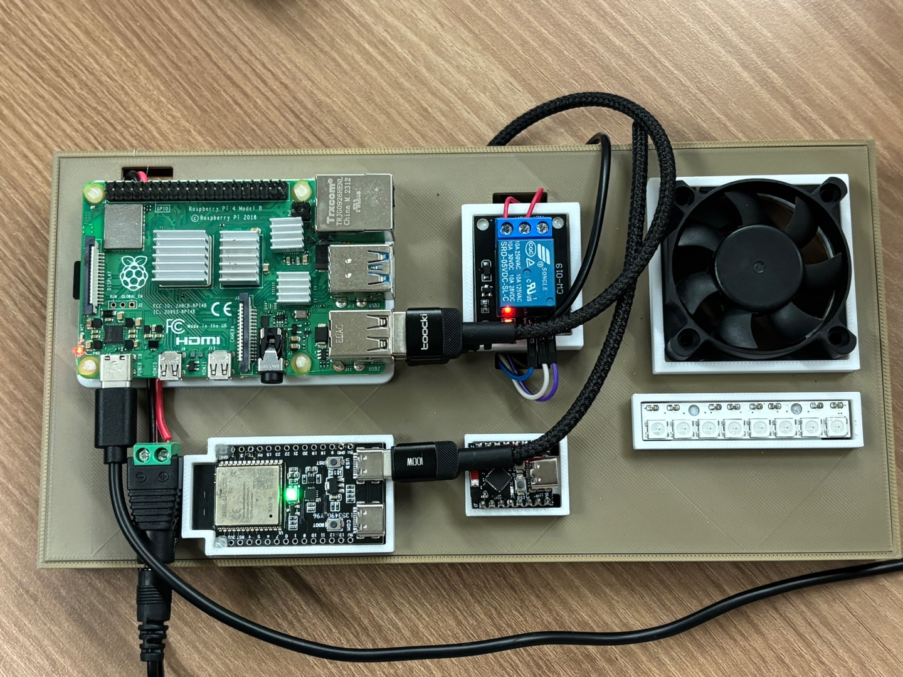

# HomeVIS 화장실 전등·환풍기



사진은 전체 센싱 모듈입니다. 이 폴더는 조명·환풍기 제어 펌웨어이며, Raspberry Pi의 센싱 처리는 [ai-wifi-sensing](../../../ai-wifi-sensing/README.md)에서 확인해 주세요. CSI 송수신 ESP32 펌웨어는 이번 원본 폴더에 포함되어 있지 않습니다.

ESP32-C3 SuperMini 한 대에서 WS2812B 전등과 릴레이 환풍기를 독립적으로 제어합니다.
ESP-IDF 5.5.4 프로젝트이며, MQTT 기기 ID는 전등 `light-00`, 환풍기 `fan-02`입니다.

## 배선과 초기 상태

| 장치 | 기본 연결 | 설정 |
| --- | --- | --- |
| WS2812B DIN | GPIO4 | `TLF_LED_GPIO` |
| WS2812B 개수 | 1개 | `TLF_LED_COUNT`, 1~120개 |
| 환풍기 릴레이 IN | GPIO5 | `TLF_RELAY_GPIO` |
| 릴레이 극성 | LOW일 때 ON | `TLF_RELAY_ACTIVE_LOW` |
| LED 흰색 출력 상한 | RGB 각 채널 32/255 | `TLF_LED_MAX_BRIGHTNESS` |

- WS2812B는 별도 용량이 충분한 5V 전원에서 공급하고, 보드·LED·릴레이 모듈의 GND를 공통으로 연결합니다.
- 5V WS2812B의 DIN은 74AHCT125 등 3.3V→5V 신호 변환기를 거쳐 연결하는 구성을 권장합니다.
- 릴레이는 3.3V 입력 호환 드라이버 모듈을 사용합니다. 릴레이 코일을 GPIO에 직접 연결하지 않습니다.
- 팬은 릴레이의 COM/NO 접점을 사용하면 릴레이 OFF 상태에서 꺼집니다.
- 펌웨어가 시작되면 Wi-Fi 연결 전에 전등과 릴레이를 OFF로 초기화합니다. 전원 투입·리셋 중에도
  릴레이를 OFF로 유지하려면 모듈 회로에 맞는 외부 풀업/풀다운이 필요합니다.
- GPIO2/8/9는 부팅 스트래핑 핀이므로 설정해도 실행 시 거부합니다. USB GPIO18/19와
  플래시 핀은 설정 범위에서 제외했습니다. SuperMini 변형 보드는 실제 핀 표기를 확인하세요.

모든 LED는 같은 흰색으로 표시합니다. MQTT 밝기는 0~100%이며,
실제 RGB 출력은 설정한 상한에 비례합니다. 예를 들어 상한 32에서 밝기 20%는 각 채널 약 6/255입니다.

## 환경 설정과 빌드

접속 정보와 배선 설정은 `main/Kconfig.projbuild`에서 정의합니다.
이 파일은 Git에서 제외되며, 처음 구성할 때 `main/Kconfig.projbuild.example`에서 자동 생성됩니다.
기존 로컬 파일이 있으면 덮어쓰지 않습니다. 공개 저장소에는 `.example`만 포함하세요.

```bash
# ESP-IDF 5.5.4 환경을 먼저 활성화해 주세요.
cd /path/to/2026ESWContest_smart_SSCC/embedded/toilet/toilet-light-fan
idf.py menuconfig
idf.py build
idf.py -p /dev/ttyACM0 flash monitor
```

기본 타깃은 `esp32c3`, 플래시는 4MB, 콘솔은 USB Serial/JTAG입니다.
포트는 연결한 보드에 맞춰 바꾸세요. 다른 타깃으로 만든 빌드가 있다면 먼저
`idf.py set-target esp32c3`를 실행합니다.

`HomeVIS toilet light and fan` 메뉴에서 다음 값을 설정합니다.

| 항목 | 설명 |
| --- | --- |
| Wi-Fi SSID / password | SSID는 필수, 비밀번호 공백은 개방형 네트워크 |
| MQTT broker URI | 기본 `mqtt://192.168.0.2:1883`, 실제 브로커 주소로 변경 |
| MQTT username / password | 인증을 사용하면 입력 |
| MQTT client ID | 기본 `homevis-toilet-light-fan`, 물리 보드마다 고유한 값 사용 |
| NTP server | 기본 `pool.ntp.org`, 초기 시각 동기화에 필요 |
| WS2812B / relay 설정 | GPIO, LED 개수, 출력 상한, 릴레이 극성 |

메뉴에서 입력한 값은 ESP-IDF의 로컬 `sdkconfig`에 저장됩니다.
`Kconfig.projbuild`의 `default`를 수정해도 기존 `sdkconfig` 값이 우선하므로,
이미 빌드한 뒤 값을 바꿀 때는 `menuconfig`에서도 변경하세요.
SSID가 비어 있으면 네트워크를 시작하지 않고 두 출력은 OFF 상태로 유지됩니다.

`mqtts://`는 ESP-IDF 공개 CA 인증서 번들로 검증합니다. 사설 CA 브로커는 별도 CA 적용이 필요합니다.

프로젝트 경로를 바꿨다면 기존 `build/`를 백업한 뒤 다시 빌드하세요.
생성된 CMake 캐시는 이전 절대 경로를 포함하므로 직접 편집하지 않습니다.

## MQTT 토픽

MQTT 연결은 하나이고, 전등과 환풍기의 토픽 및 상태는 분리합니다.
모든 구독·발행은 QoS 1이며 retain은 false입니다.

| 기능 | 전등 | 환풍기 |
| --- | --- | --- |
| 상태 | `home/toilet/light/light-00/state` | `home/toilet/fan/fan-02/state` |
| 명령 | `home/toilet/light/light-00/command` | `home/toilet/fan/fan-02/command` |
| 결과 | `home/toilet/light/light-00/ack` | `home/toilet/fan/fan-02/ack` |

- 상태는 연결·재연결 시, 상태 변경 시, 그리고 마지막 발행 후 5초마다 보냅니다.
- SNTP로 시각을 확보한 뒤 MQTT를 시작하며, 시각은 UTC ISO 8601(`Z`)으로 보냅니다.
- 전등 애니메이션과 팬 상태는 Wi-Fi/MQTT가 끊겨도 유지되며, 재연결 시 최신 상태를 보냅니다.
- 초기 `lastControl.publisher`는 `user`이고, 서버 명령 적용 후에는 `api`와 해당 `commandId`를 기록합니다.
- ACK는 동작 적용 또는 애니메이션 시작 직후의 상태를 담습니다. `blink`·`fadeout`의 최종 상태는
  뒤따르는 `state`로 알립니다. `applied`는 애니메이션 종료 확인을 의미하지 않습니다.
- 최근 32개 명령은 기기 종류와 `commandId`로 중복을 검사합니다. 중복이면 이전 ACK를 재전송하고
  동작을 재실행하지 않습니다. 이 이력은 RAM에 있으며 보드 재시작 시 초기화됩니다.
- 최대 명령 크기는 1024바이트이며 MQTT 분할 수신을 조립합니다. retained 명령,
  잘못된 JSON, 사용할 수 있는 `commandId`가 없는 메시지는 실행하지 않습니다.
- 유효한 `commandId`가 있는 잘못된 명령에는 `rejected`와 `reason`을 보냅니다.
  하드웨어 출력 API가 실패하면 `failed`를 보냅니다.
- 처리 대기열은 8개, ACK 이력은 32개, MQTT 송신 대기열은 16KiB로 제한합니다.
  대기열이 가득 찬 경우 실행하지 않고 로그를 남기므로, 서버는 ACK가 없으면 같은 `commandId`로 재시도해야 합니다.
- `state`는 소프트웨어가 출력한 상태이며 별도 전류·접점 피드백 센서로 검증한 값은 아닙니다.

## 전등 명령

각 JSON은 하나의 독립적인 MQTT 메시지입니다.

```json
{"commandId":"light-on-1","issuedAt":"2026-10-27T15:00:00+09:00","deviceId":"light-00","type":"on","brightness":100}
```

```json
{"commandId":"light-off-1","issuedAt":"2026-10-27T15:00:01+09:00","deviceId":"light-00","type":"off"}
```

```json
{"commandId":"light-blink-1","issuedAt":"2026-10-27T15:00:02+09:00","deviceId":"light-00","type":"blink","durationSec":10}
```

```json
{"commandId":"light-save-1","issuedAt":"2026-10-27T15:00:03+09:00","deviceId":"light-00","type":"fadeout","brightness":20,"durationSec":3}
```

- `on`: 즉시 100%로 켭니다. `brightness`는 생략 가능하며, 보내면 100이어야 합니다.
- `off`: 즉시 끕니다. 진행 중인 깜빡임·절전 애니메이션도 취소합니다.
- `blink`: 500ms 간격으로 켜고 끈 뒤 이전 상태로 돌아갑니다. 진행 중이던 fadeout이 있다면
  원래 시간 기준으로 복귀하며, 그 사이 새 `on`/`off`가 오면 이전 상태로 되돌아가지 않습니다.
- `fadeout`: 현재 밝기에서 목표 밝기까지 선형으로 낮추고 전원을 유지합니다.
  절전 예시는 20%이며, 목표 범위는 1~100입니다. 꺼진 전등이나 현재보다 높은 목표 밝기는 거부합니다.
- `durationSec`는 1~3600의 정수입니다. 복귀 시 `on`을 보내면 100%로 돌아옵니다.

## 환풍기 명령

```json
{"commandId":"fan-on-1","issuedAt":"2026-10-27T15:00:00+09:00","deviceId":"fan-02","type":"on"}
```

```json
{"commandId":"fan-off-1","issuedAt":"2026-10-27T15:00:01+09:00","deviceId":"fan-02","type":"off"}
```

단일 릴레이는 전원만 제어하므로 `set_speed`는 `rejected`와
`reason: "unsupported_speed_control"`로 응답합니다. 팬을 임의로 켜거나 풍량을 바꾸지 않습니다.
기존 서버 형식과 호환하기 위해 `state.speed`는 고정값 `mid`로 보내고
`speedControllable: false`를 추가합니다. 이 `mid`는 실제 중간 풍량 측정값이 아닙니다.

## 검증

호스트 테스트는 일반 개발용 셸에서 `IDF_PATH`를 설치된 ESP-IDF 5.5.4 경로로 지정해 실행해 주세요. 교차 링커가 우선되는 경우의 실행 방법은 [공통 검증 안내](../../README.md#빌드와-검증)를 참고해 주세요.

```bash
ASAN_OPTIONS=detect_leaks=0 sh tests/run.sh
```

호스트 테스트는 명령 검증, 전등·팬 독립 동작, 깜빡임 복귀, 절전 밝기 전환,
즉시 OFF와 JSON 응답을 검사합니다. AddressSanitizer와 UndefinedBehaviorSanitizer를 사용합니다.
ptrace 환경에서 LeakSanitizer가 실행되지 않으면 `ASAN_OPTIONS=detect_leaks=0`을 붙여 실행하세요.
실제 WS2812B 신호·릴레이 극성·전원 배선·브로커 연동은 연결한 보드에서 확인해야 합니다.

참고: [ESP-IDF RMT 드라이버](https://docs.espressif.com/projects/esp-idf/en/v5.5.4/esp32c3/api-reference/peripherals/rmt.html),
[ESP-MQTT](https://docs.espressif.com/projects/esp-idf/en/v5.5.4/esp32c3/api-reference/protocols/mqtt.html),
[ESP32-C3 GPIO 제약](https://docs.espressif.com/projects/esp-hardware-design-guidelines/en/latest/esp32c3/schematic-checklist.html).
